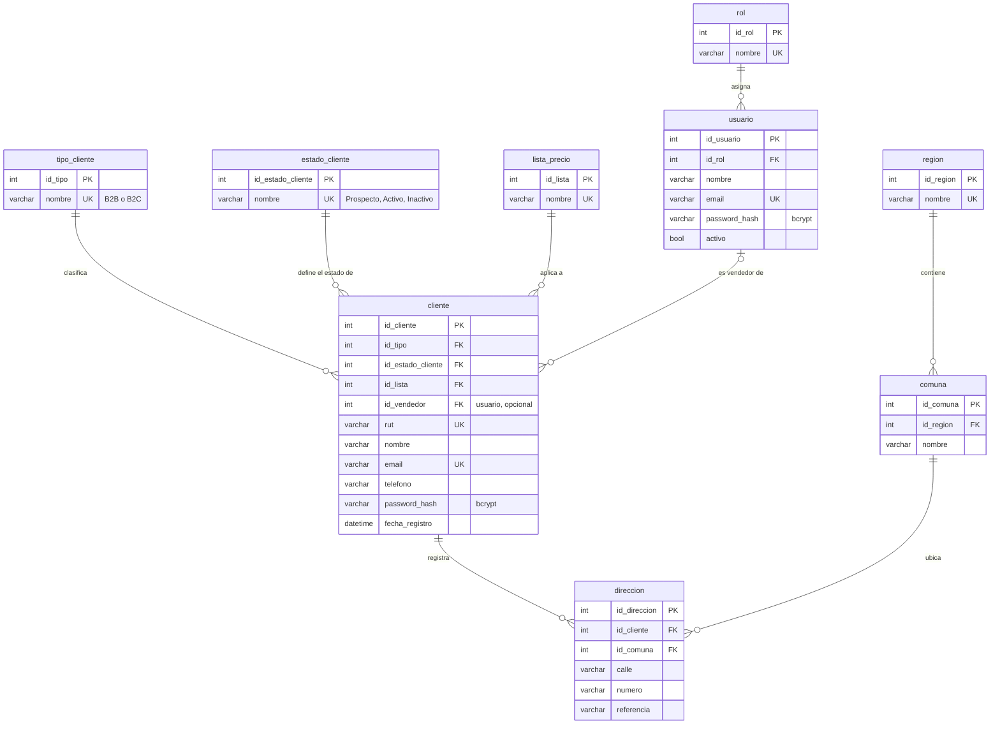
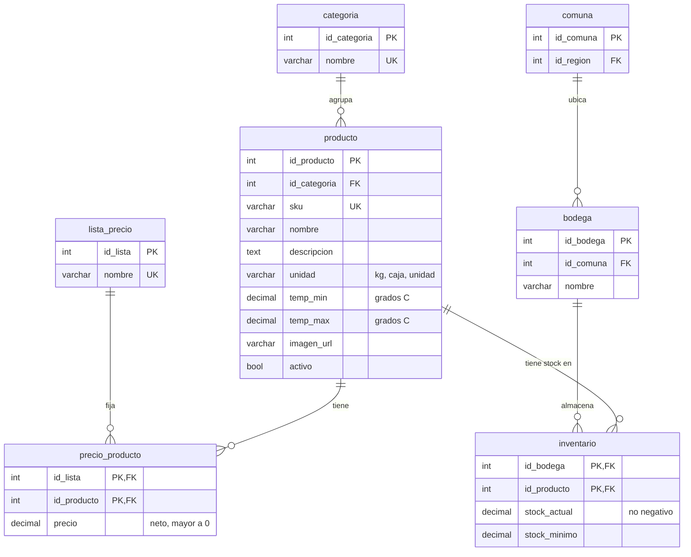
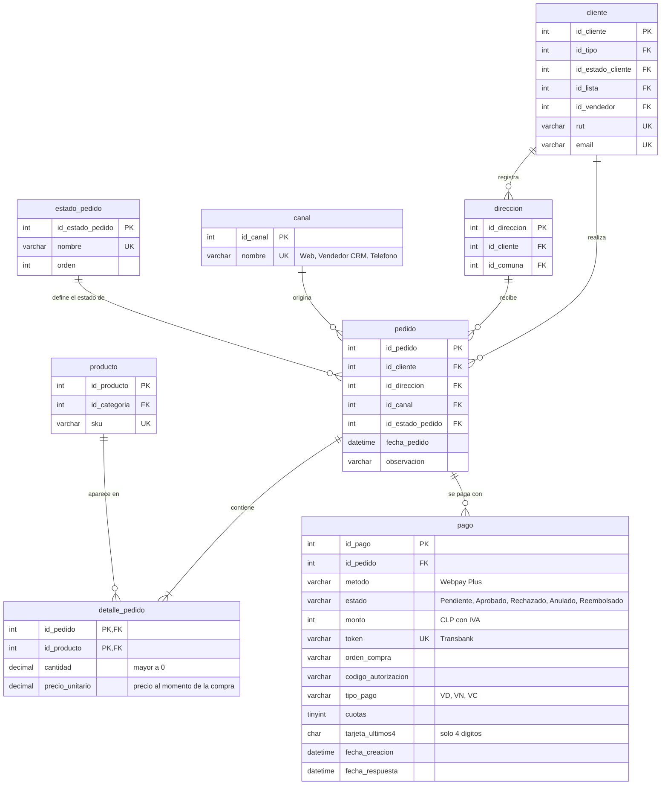
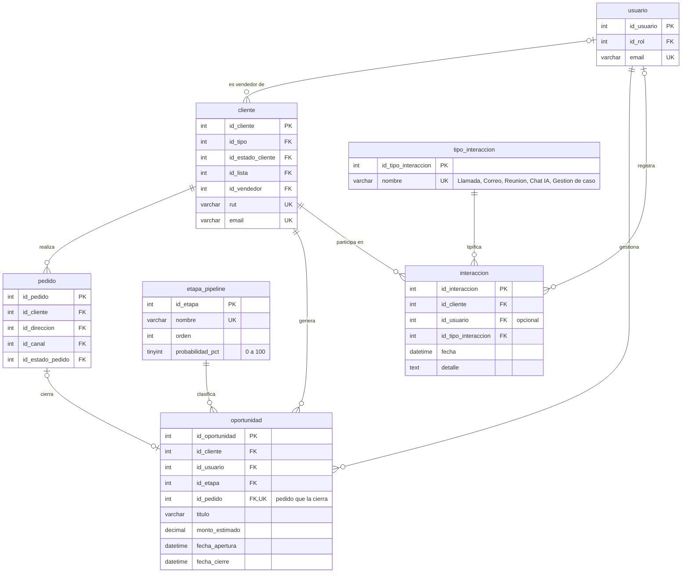
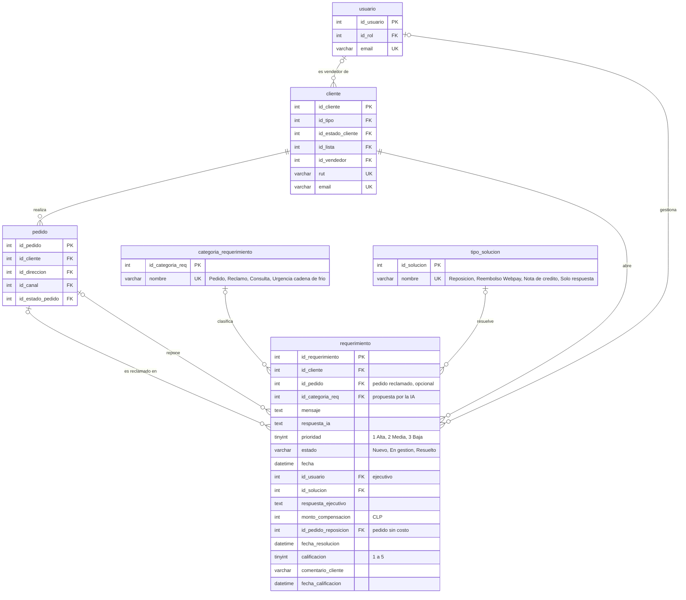
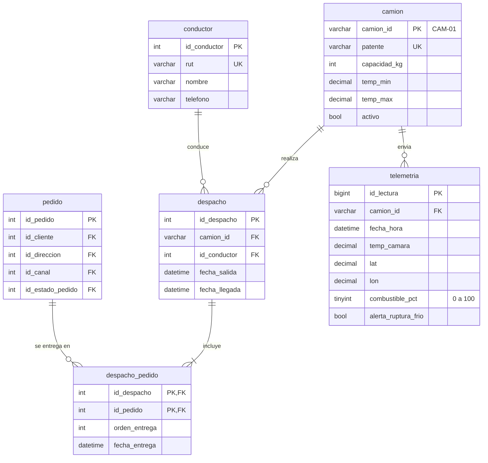

# MER · cofrial_db

Modelo entidad-relación de la base de datos de Cofrial SpA (MySQL 8 en Amazon RDS): **31 tablas**, **39 relaciones** y **6 vistas**, en tercera forma normal.
GitHub dibuja los diagramas automáticamente. Para exportarlos como imagen, copia el bloque en https://mermaid.live y descarga PNG o SVG.

## Cambios respecto del Hito 1

| Objeto | Cambio | Detalle |
| --- | --- | --- |
| `pago` | Nueva | Pasarela Webpay Plus para clientes B2C. Guarda el token de Transbank, el código de autorización y solo los 4 últimos dígitos de la tarjeta. Estados: Pendiente, Aprobado, Rechazado, Anulado, Reembolsado. |
| `tipo_solucion` | Nueva | Catálogo de soluciones de un caso: Reposición, Reembolso Webpay, Nota de crédito y Solo respuesta. |
| `requerimiento` | Modificada | La columna resuelto (sí/no) se reemplaza por estado (Nuevo, En gestión, Resuelto). Se agregan el ejecutivo que lo gestiona, la solución, la respuesta al cliente, el monto compensado, el pedido de reposición y la encuesta de satisfacción (calificación y comentario). |
| `tipo_interaccion` | Nuevo dato | Se agrega el tipo «Gestión de caso» para dejar registro en la ficha del cliente cada vez que se resuelve un caso. |
| `v_caso` | Nueva vista | Calcula el plazo de cada caso según su prioridad (Alta 2 h, Media 24 h, Baja 72 h), si se cumplió y cuántas horas tomó resolverlo. |

## Seguridad, geografía y clientes

Usuarios internos con su rol, clientes B2B y B2C con su lista de precios y vendedor asignado, y sus direcciones de despacho por comuna.

## Catálogo e inventario

Productos con su rango de temperatura, precio por lista (B2C, Institucional Salud, Supermercados, Ferias) y stock por bodega.

## Pedidos y pagos

El pedido guarda el precio de cada línea al momento de la compra. Los clientes B2C pagan con Webpay Plus; un pedido puede tener varios intentos de pago.

## CRM comercial

Pipeline de oportunidades por etapa y bitácora de interacciones con cada cliente. Una oportunidad se cierra con un pedido.

## Atención al cliente (casos IA)

Cada mensaje del chat es un caso clasificado por la IA. El ejecutivo lo resuelve con una solución y el cliente califica la atención. El plazo se calcula en la vista v_caso.

## Logística e IoT

Despachos en camión refrigerado y telemetría que cada camión envía cada 5 segundos. El cruce despacho-telemetría es la evidencia de los reclamos de cadena de frío.

## Vista general (31 tablas, solo claves)

```mermaid
erDiagram
  rol ||--o{ usuario : "asigna"
  region ||--o{ comuna : "contiene"
  tipo_cliente ||--o{ cliente : "clasifica"
  estado_cliente ||--o{ cliente : "define el estado de"
  lista_precio ||--o{ cliente : "aplica a"
  usuario |o--o{ cliente : "es vendedor de"
  cliente ||--o{ direccion : "registra"
  comuna ||--o{ direccion : "ubica"
  categoria ||--o{ producto : "agrupa"
  lista_precio ||--o{ precio_producto : "fija"
  producto ||--o{ precio_producto : "tiene"
  comuna ||--o{ bodega : "ubica"
  bodega ||--o{ inventario : "almacena"
  producto ||--o{ inventario : "tiene stock en"
  cliente ||--o{ pedido : "realiza"
  direccion ||--o{ pedido : "recibe"
  canal ||--o{ pedido : "origina"
  estado_pedido ||--o{ pedido : "define el estado de"
  pedido ||--|{ detalle_pedido : "contiene"
  producto ||--o{ detalle_pedido : "aparece en"
  pedido ||--o{ pago : "se paga con"
  cliente ||--o{ oportunidad : "genera"
  usuario ||--o{ oportunidad : "gestiona"
  etapa_pipeline ||--o{ oportunidad : "clasifica"
  pedido |o--o| oportunidad : "cierra"
  cliente ||--o{ interaccion : "participa en"
  usuario |o--o{ interaccion : "registra"
  tipo_interaccion ||--o{ interaccion : "tipifica"
  cliente ||--o{ requerimiento : "abre"
  pedido |o--o{ requerimiento : "es reclamado en"
  categoria_requerimiento |o--o{ requerimiento : "clasifica"
  usuario |o--o{ requerimiento : "gestiona"
  tipo_solucion |o--o{ requerimiento : "resuelve"
  pedido |o--o{ requerimiento : "repone"
  camion ||--o{ despacho : "realiza"
  conductor ||--o{ despacho : "conduce"
  despacho ||--|{ despacho_pedido : "incluye"
  pedido ||--o{ despacho_pedido : "se entrega en"
  camion ||--o{ telemetria : "envia"
  rol {
    int id_rol PK
    varchar nombre UK
  }
  usuario {
    int id_usuario PK
    int id_rol FK
    varchar email UK
  }
  region {
    int id_region PK
    varchar nombre UK
  }
  comuna {
    int id_comuna PK
    int id_region FK
  }
  tipo_cliente {
    int id_tipo PK
    varchar nombre UK
  }
  estado_cliente {
    int id_estado_cliente PK
    varchar nombre UK
  }
  lista_precio {
    int id_lista PK
    varchar nombre UK
  }
  cliente {
    int id_cliente PK
    int id_tipo FK
    int id_estado_cliente FK
    int id_lista FK
    int id_vendedor FK
    varchar rut UK
    varchar email UK
  }
  direccion {
    int id_direccion PK
    int id_cliente FK
    int id_comuna FK
  }
  categoria {
    int id_categoria PK
    varchar nombre UK
  }
  producto {
    int id_producto PK
    int id_categoria FK
    varchar sku UK
  }
  precio_producto {
    int id_lista PK, FK
    int id_producto PK, FK
  }
  bodega {
    int id_bodega PK
    int id_comuna FK
  }
  inventario {
    int id_bodega PK, FK
    int id_producto PK, FK
  }
  canal {
    int id_canal PK
    varchar nombre UK
  }
  estado_pedido {
    int id_estado_pedido PK
    varchar nombre UK
  }
  pedido {
    int id_pedido PK
    int id_cliente FK
    int id_direccion FK
    int id_canal FK
    int id_estado_pedido FK
  }
  detalle_pedido {
    int id_pedido PK, FK
    int id_producto PK, FK
  }
  pago {
    int id_pago PK
    int id_pedido FK
    varchar token UK
  }
  etapa_pipeline {
    int id_etapa PK
    varchar nombre UK
  }
  oportunidad {
    int id_oportunidad PK
    int id_cliente FK
    int id_usuario FK
    int id_etapa FK
    int id_pedido FK, UK
  }
  tipo_interaccion {
    int id_tipo_interaccion PK
    varchar nombre UK
  }
  interaccion {
    int id_interaccion PK
    int id_cliente FK
    int id_usuario FK
    int id_tipo_interaccion FK
  }
  categoria_requerimiento {
    int id_categoria_req PK
    varchar nombre UK
  }
  tipo_solucion {
    int id_solucion PK
    varchar nombre UK
  }
  requerimiento {
    int id_requerimiento PK
    int id_cliente FK
    int id_pedido FK
    int id_categoria_req FK
    int id_usuario FK
    int id_solucion FK
    int id_pedido_reposicion FK
  }
  camion {
    varchar camion_id PK
    varchar patente UK
  }
  conductor {
    int id_conductor PK
    varchar rut UK
  }
  despacho {
    int id_despacho PK
    varchar camion_id FK
    int id_conductor FK
  }
  despacho_pedido {
    int id_despacho PK, FK
    int id_pedido PK, FK
  }
  telemetria {
    bigint id_lectura PK
    varchar camion_id FK
  }
```

## Vistas

| Vista | Qué calcula |
| --- | --- |
| `v_pedido_total` | Total neto y con IVA de cada pedido, calculado desde sus líneas. |
| `v_ventas_diarias` | Pedidos y ventas netas por día, sin cancelados. |
| `v_alertas_diarias` | Alertas de ruptura de frío y lecturas por día. |
| `v_ventas_vs_alertas` | Cruce comercial y operativo por día para el BI. |
| `v_ultima_lectura` | Última lectura de cada camión con su rango permitido. |
| `v_caso` | Casos con su plazo (SLA), cumplimiento y horas de resolución. |

## Por qué está en 3FN

- **Sin datos derivados almacenados.** Los totales del pedido, las ventas diarias y el plazo de cada caso no se guardan: se calculan en vistas. Así nunca quedan desactualizados.
- **Catálogos en tablas propias.** Estados, canales, tipos, categorías, etapas y soluciones viven en tablas de referencia. Ninguna descripción se repite en las tablas principales.
- **Relaciones muchos a muchos resueltas.** precio_producto (lista × producto), inventario (bodega × producto), detalle_pedido (pedido × producto) y despacho_pedido (despacho × pedido) usan clave primaria compuesta.
- **El precio de venta se guarda en la línea.** detalle_pedido.precio_unitario no es redundante: registra el precio al momento de la compra, que puede cambiar después en la lista de precios.
